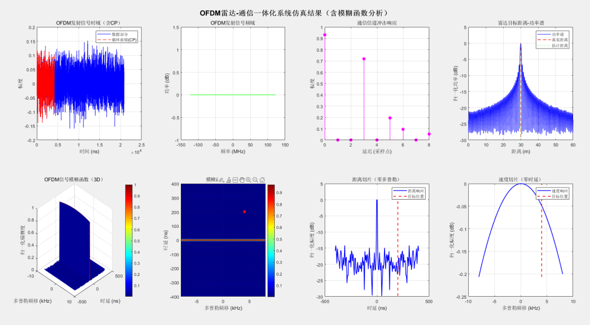
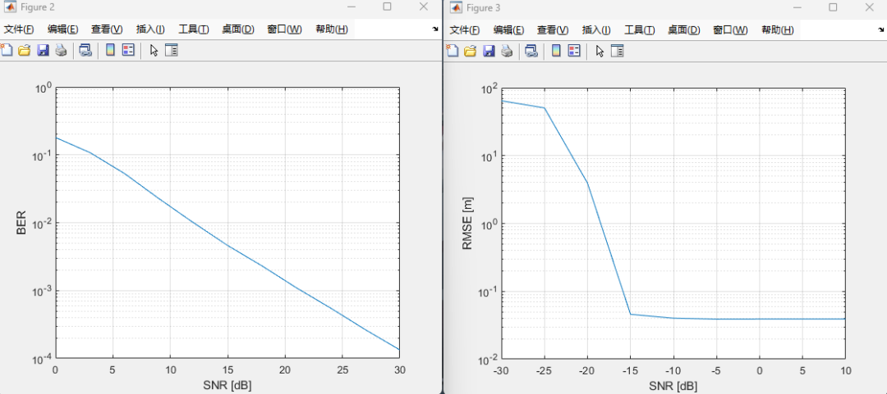

# Radar Communication Integrated - OFDM Radar - Communications Integrated System Simulation [Attached MATLAB Code]

1. System Parameter Configuration: OFDM Integrated System
1.1 The basic parameters for the module defining the core physical and signal parameters supporting communication and radar functions must meet the orthogonality of the OFDM system and be practical for engineering.
Parameters Category  
Key Parameters  
Numeric / Set  
Principle Function, Core Formulas, and Physical Layer Parameters  
Carrier Frequency f_c  
30GHz (millimeter wave)  
Determines the signal wavelength, formula: (assuming light speed, calculated), affecting the precision of radar Doppler frequency shift.  
OFDM Frame Structure  
Subcarrier Number N  
256  
Condition for subcarrier orthogonality: Subcarrier interval (as symbol duration), larger, higher frequency domain resolution.  
Symbol Number M  
16  
Forms an OFDM data block, balancing communication rate (total) with radar detection precision.  
Subcarrier Interval Δf  
1.536MHz  
Symbol duration, ensuring subcarrier orthogonality (subcarriers overlapping to zero within the symbol period).  
Cyclic Prefix (CP)  
Length 64 (unit)  
CP duration, greater than channel maximum delay to combat intersymbol interference (ISI); total symbol period.  
Communication Modulation Parameters  
Modulation Method  
4-QAM (4-Quadrature Amplitude Modulation)  
Each subcarrier carries 2 bits of data, mapping relationship (e.g., 00→, 01→, etc.), normalized power to ensure signal amplitude stability.
II. Transmitter Module: Generation Core of OFDM Integrated Signals
The core of generating OFDM time-domain signals that serve both communication transmission and radar detection is to modulate communication data into a signal satisfying orthogonality, which simultaneously serves as both communication transmission and radar detection signals, achieving "one signal dual use".
Signal Generation Process and Principles:
1. Generation of Communication Data and QAM Modulation•
Generate (256×16) random binary data matrix data, representing the communication information to be transmitted.
•
4-QAM Modulation: Map the binary data into complex baseband symbols through the qammod function, meeting the condition of normalized power:
The output is the modulated symbol (;) for the QAM modulation of the subcarrier and the symbol, followed by the TxData after modulation in the frequency domain.
2. OFDM modulation: from frequency domain to time domain (IFFT + CP)
IFFT Transform: Point-inversion Fourier Transform of the QAM symbols, converting the frequency domain signal into time domain OFDM symbols.
The code uses the IFFT function (TxData, N) to obtain the time-domain symbol matrix TxSignal_IFTT (dimension).
•  
Adding a cyclic prefix (CP): Copy the last (64) samples of each time-domain symbol to the beginning of the symbol, forming a symbol with CP:
The code represents [TxSignal_IFTT(N-CPsize+1:N, :); TxSignal_IFTT] and outputs the dimension of TxSignal_cp.
•  
Signal shaping: concatenating symbols with CP into a one-dimensional time domain signal.
The code is implemented through reshape(TxSignal_cp, [], 1) to obtain the final emission signal TxSignal_time.
3. Communication Channel and Receive: OFDM Data Transmission under Multipath Channels This module simulates the signal transmission and reception recovery of a communication link. The core is to combat multipath fading and noise interference. Verification of the reliability of communication functions (measured by bit error rate).
1. Communication Channel Modeling: Rayleigh Fading Multipath Channel
Multipath channel impulse response: The multipath characteristics of actual wireless channels can be described using the impulse response of a linear time-invariant (LTI) system.
Among them:
The code generates the channel impulse response h (dimension,) by using h(Delay+1) = (randn + 1j*randn) .* sqrt(Power/2).
•  
(Channel tap number), the time delay of each tap (in code, Delay = [0,3,5,6,8], unit: sampling points);
•  
2. Signal Transmission and Receive Processing
Code Operation
Core Principles and Formulas
Channel Transmission
Conv(TxSignal_time, h) - The transmission of signals in a multipath channel is equivalent to time-domain convolution: , reflecting the effect of multipath signal superposition.
Additive Noise
awgn(..., ComSNRdB=15) - Add Gaussian White Noise (AWGN), where SNRdB is defined as: $\text{SNR}_{\text{dB}} = 10\log_{10}\left(\frac{E[X]}{\sqrt{N}}\right)$, where $E[X]$ is the expected value of the signal power, and $N$ is the noise power spectral density.
Pre-processing at the receiver
- CP removal (cutting off the second half of the signal): eliminates Intersymbol Interference (ISI);
- FFT transformation (fft): converts the time-domain signal back into the frequency domain (the frequency domain channel response, the frequency domain noise), outputting RxData_com.
Channel equalization (MMSE)
C = conj(H_channel) / (abs(H_channel).2 + 1/(10(ComSNRdB/10))) - Minimum Mean Square Error (MMSE) equalizer, calculates the equalization coefficient $C_k$ by using the frequency domain channel response.
Demodulation and Bit Error Statistics
QAM demodulation
- Demodulation: maps the equalized frequency domain symbols back to binary data;
- Bit error rate: counts the differences between the original data and the demodulated data in binary form, reflecting the reliability of communication.
4. Radar Channel and Target Detection: Based on OFDM Signal for Range Estimation
This module utilizes the "target reflection echo" from the same OFDM transmission signal to implement radar functionality, with the core being through time delay estimation of target distance and Doppler shift estimation of speed (the distance estimation is currently implemented in the code).
1. Radar Target Parameters and Backscatter Modeling (1) Derivation of Target Core Parameters•  
Bi-directional Delay: The time it takes for a signal to travel back and forth to the target, related to the target distance:  
The target distance calculated in the code (target_delay).  
•  
Doppler Shift: The frequency offset caused by moving targets, related to the target speed:  
The target speed, wavelength, calculated in the code (target_dop).  
(2) Radar Backscatter Signal Model: The target reflection backscatter signal in the frequency domain can be represented as:  
In which:  
•  
(Radar Signal-to-Noise Ratio, RadarSNRdB=30);  
•  
Phase Offset (caused by both delay and Doppler):  
(Subcarrier index, Symbol index, generated by meshgrid in the code to calculate kSub, mSym);  
•  
Complex Gaussian noise for the radar backscatter (randn(N,M) + 1j*randn(N,M)).  
The code outputs the radar backscatter frequency domain signal RxData_radar.  
2. Range Estimation Process 1. Demodulation (Signal Purification) to eliminate the modulation information from the transmitted signal, extracting phase information related to the target:  
The code uses dividerArray = RxData_radar / TxData to remove the effects of modulation symbols.  
2. Range-Domain FFT (Delay Estimation) to perform IFFT along the subcarrier direction (dimension) on the demodulated signal, converting the frequency domain phase information into time domain delay information.
In the code, the zero-padding and resolution enhancement are implemented through the IFFT function (dividerArray, NPer, 1) to output range_fft.
3. Distance Calculation •
Power Spectrum: suppress noise along the symbol direction (dimension) by averaging over the range of mean values (coded as mean_range_power).
•  
Distance axis: Based on the relationship between delay and distance, combined with FFT resolution, the formula for the distance axis is:
•  
Estimated distance: Find the index corresponding to the power spectrum peak, then estimate the distance (coded as distanceE) to verify radar accuracy against the actual distance.
V. Calculation of Ambiguity Function: Assessing the Resolving Power of Radar Signals
1. Definition and Computation of Fuzzy Functions (1) Mathematical definition for an emission signal, the fuzzy function is the amplitude of the cross-correlation between the signal and "the signal after time shift + Doppler shift".
The peak position corresponds to the true and f_d_0 for both target Doppler shift (corresponding to velocity) and target delay (corresponding to distance).
.  
(2) Code Computation Process 1
Setting analysis range: Time delay range ( ), Doppler range ( f_{d,\text{max}} = 2f_d_0
(Each takes 150 sampling points (tau_points=150, fd_points=150).)
2  
Time-shift signal generation: Perform time-shift on the transmitted signal, ensuring the precision of time-shift for non-integer sampling points through linear interpolation (interp1), resulting in (code snippet: s_tau_padded).
3  
Doppler Shift: Multiply the time-shifted signal by the Doppler shift factor (coded as doppler_shift).
4  
Cross-correlation calculation: For each, compute the resulting fuzzy function matrix ambiguity_func, and normalize it (divided by the maximum value).
2. Key Slice Analysis •
Slice Distance: Fixed Doppler shift, extract the slice of the convolution function along the delay axis to reflect the signal's distance resolution.
Distance
Leave
Divided
Discrimination
Force
The OFDM signal bandwidth, the narrower the main lobe, the higher the distance resolution (coded as range_slice).
•  
Speed slicing: fixed delay, extract the fuzzy function in the Doppler axis section, reflect the signal's velocity resolution:
Fast
Degree
Divided
Discrimination
Force
Among them, the total signal duration is considered. The narrower the main lobe, the higher the speed resolution (coded as `do`).
End

## Images

<!-- PAYMENT_BLOCK -->

## Get this dataset

- Payment link (Stripe): [Buy now](https://buy.stripe.com/3cs8yP7sY87d0vu9AB)
- Payment QR code: 

<!-- /PAYMENT_BLOCK -->
